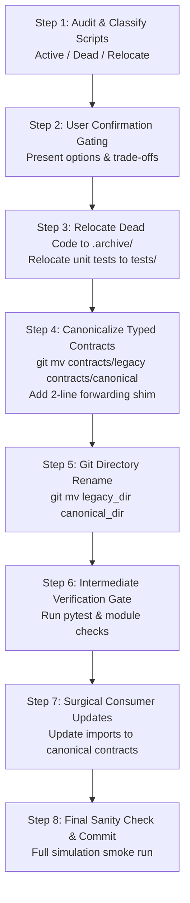

# Minimal-Diff Migration Protocol

This reference describes the step-by-step protocol for migrating legacy naming conventions (e.g., `gate1/` $\to$ `calibration/`, `gate2/` $\to$ `profiling/`) with minimal line churn and zero risk of regression.

---

## 1. The Core Principles

1. **Zero Script Renaming**: Preserve established script basenames (`download_datasets.py`, `recalibrate_onnx.py`, `profile_triton_service.py`). Avoid cosmetic renames that churn documentation, runbooks, and mental models.
2. **Metadata Git Moves**: Use `git mv` so git tracks moves as pure tree renames with 0 line changes to file contents.
3. **Contract Forwarding Shims**: Place thin re-export shims at legacy contract locations to keep legacy callers functional while consumers migrate.
4. **Targeted Consumer Updates**: Update direct imports in small, isolated batches ($\le 15$ lines per commit).
5. **No Lingering Symlinks or Silent Fallbacks**: Once downstream consumers are updated and tested, remove transition shims and temporary symlinks so the final repository state is clean.

---

## 2. Migration Execution Flow



---

## 3. Contract Shim Pattern

When moving `contracts/gate1.py` $\to$ `contracts/calibration.py`:

```python
# contracts/gate1.py (Shim for transition)
"""
contracts/gate1.py — Backward-compatibility forwarding shim for contracts.calibration.
"""
from contracts.calibration import *  # noqa: F401, F403
```

This guarantees:
- Any script importing `from contracts.gate1 import load_gate1_config` continues to run without error.
- Downstream files can be migrated one by one without breaking the test suite.

---

## 4. Output Manifest & .gitignore Protection

When renaming directories that contain evaluation outputs (e.g. `gate1/output/` $\to$ `calibration/output/`):
1. **Never alter or delete raw results**: Existing `.json`, `.npz`, and `.png` results must remain bit-for-bit identical.
2. **Update `.gitignore` immediately**: Ensure new output directory paths are added to `.gitignore` so that runtime artifacts do not dirty the git index:
   ```gitignore
   # Update ignore patterns to match new names
   calibration/output/
   profiling/output*/
   ```
