# Conformal-Gated Dual-Horizon Autoscaler (CGDA)

[](https://www.python.org/downloads/)
[](#project-status)
[](#testbed-architecture)
[-green.svg)](REPRODUCE.md)
[-purple.svg)](assets/cgda_explainer.mp4)

> **Research Project & Manuscript Underway**  
> *Feed-forward complexity telemetry for heterogeneous serving cascades in the edge-cloud continuum.*

---

## 🎬 Video Explainer (1m 49s with Neural Narration)

> **Watch the full walkthrough** covering the complexity blindness paradox, mathematical conformal triage, dual-horizon preemption, and the boot delay benchmark:

<div align="center">
  <a href="assets/cgda_explainer.mp4">
    
  </a>
  <p>
    <em>▶ <strong><a href="assets/cgda_explainer.mp4">Watch Full HD 1080p60 Video with Jenny's Neural Voiceover (1m 49s)</a></strong> &bull; Click animation to open full video with audio</em>
  </p>
</div>

<details>
<summary><b>🎞️ Click to view scene breakdown & keyframes (6 scenes)</b></summary>

| Scene | Keyframe | Topic Covered |
| :--- | :---: | :--- |
| **1. Paradox** | <a href="assets/video_stills/01_complexity_blindness.png">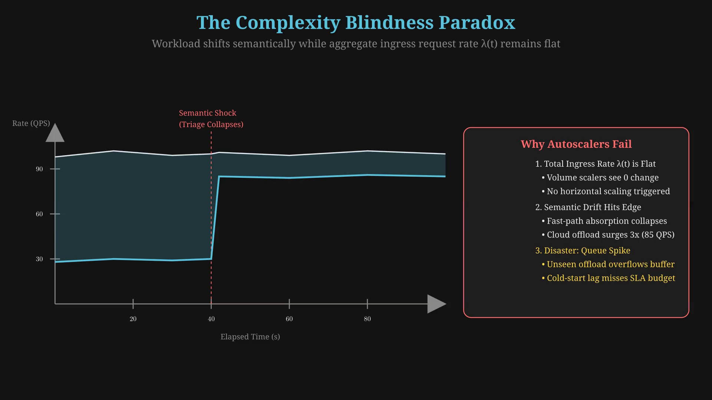</a> | **Complexity Blindness**: Flat ingress $\lambda(t)=100$ QPS while semantic drift triples cloud offload to 85 QPS. |
| **2. Triage** | <a href="assets/video_stills/02_conformal_triage.png">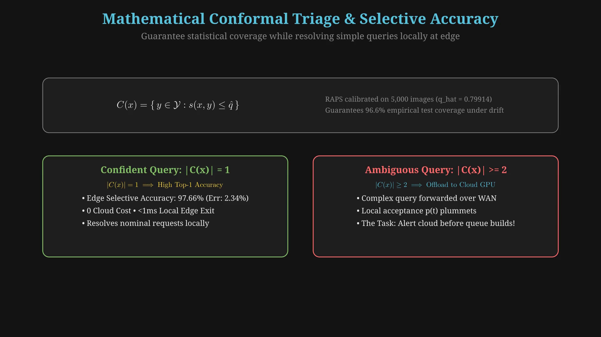</a> | **Conformal Triage**: RAPS $|C(x)|=1 \implies$ **97.66% selective top-1 accuracy** resolved locally at edge. |
| **3. Derivative** | <a href="assets/video_stills/03_telemetry_derivative.png">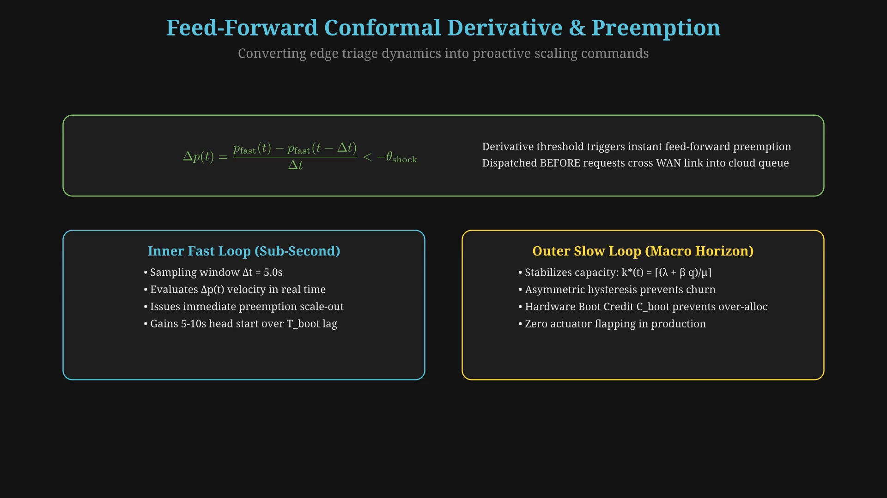</a> | **Telemetry Derivative**: $\Delta p(t) < -\theta_{\text{shock}}$ alerts cloud before queue backlog accumulates. |
| **4. Trajectory** | <a href="assets/video_stills/04_dynamic_trajectories.png">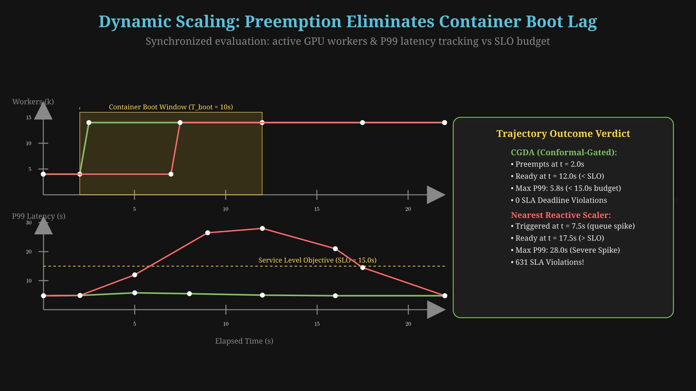</a> | **Dynamic Trajectories**: Preemptive boot completes ahead of deadline ($5.8\text{ s} \ll 15.0\text{ s}$ SLO; 0 misses). |
| **5. Benchmark** | <a href="assets/video_stills/05_boot_delay_ladder.png">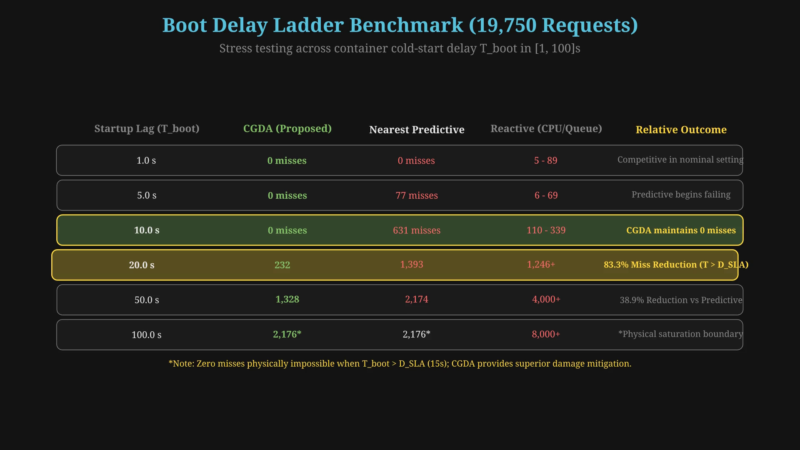</a> | **Boot Delay Ladder**: 0 misses up to 10s; 83.3% miss reduction at 20s; 38.9% reduction at 50s. |
| **6. Portability** | <a href="assets/video_stills/06_universal_portability.png">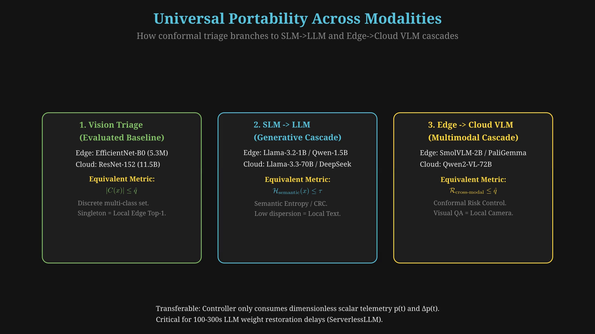</a> | **Universal Portability**: Dimensionless telemetry transferred to SLM $\to$ LLM and Edge $\to$ Cloud VLM cascades. |

</details>

---

## Overview: The "Complexity Blindness" Problem

Modern edge-cloud machine learning pipelines serve inference requests through cascaded architectures: a lightweight triage model running at an edge gateway (e.g., EfficientNet-B0) resolves simple queries locally, offloading ambiguous, high-complexity requests to heavy GPU models in the cloud (e.g., ResNet-152).

Existing production autoscalers—including reactive CPU-utilization rules (Kubernetes HPA), queue-backlog triggers (KEDA), and predictive traffic-envelope planners (InferLine)—suffer from **complexity blindness**:


1. **Blindness to Semantic Drift**: Standard controllers observe only aggregate ingress request rate $\lambda(t)$ or cloud queue depth $q(t)$. When incoming workloads shift toward semantically difficult queries (adverse illumination, rare classes, distribution shifts), edge triage offloads a higher percentage of requests to the cloud, even while aggregate arrival rate $\lambda(t)$ remains flat.
2. **The Container Cold-Start Race**: By the time cloud queue backpressure materializes, container startup delay $T_{\text{boot}}$ (which ranges from seconds for warm snapshots to $100\text{--}300\text{ s}$ for large models) already exceeds the remaining SLA deadline budget $D_{\text{SLA}}$. Reactive scaling commands arrive too late, causing severe tail-latency spikes and deadline misses.

### The CGDA Solution

The **Conformal-Gated Dual-Horizon Autoscaler (CGDA)** eliminates complexity blindness by instrumenting **RAPS (Regularized Adaptive Prediction Sets)** conformal prediction set cardinality $|C(x)|$ as real-time, feed-forward complexity telemetry:

- **Fast Inner Loop (Sub-Second / 5.0s Epoch)**: Computes local triage acceptance $p_{\text{fast}}(t)$ and drift velocity $\Delta p(t)$. When negative velocity indicates an imminent offload surge ($\Delta p(t) < -\theta_{\text{shock}}$), CGDA issues preemptive scale-out commands *before* cloud queue backlog accumulates.
- **Slow Outer Loop (Capacity Stabilization)**: Anchors steady-state worker capacity $k^{\star}(t) = \lceil (\lambda_{\text{slow}}(t) + \beta q(t))/\mu \rceil$ using asymmetric hysteresis and a hardware booting-credit register $C_{\text{boot}}(t)$ that prevents over-provisioning and scaling churn.

---

## Edge Triage Synthesis: Distillation, Portability & Foundation Models

### 1. ResNet-152 to EfficientNet-B0 Knowledge Distillation
The edge triage gateway requires low-latency, deterministic execution within a tight compute budget (profiled under a strict $150\text{ mCPU}$ Linux cgroups quota). To achieve high teacher fidelity without the heavy computational burden of cloud models, we synthesize the edge model via **Knowledge Distillation (KD)**:

- **Teacher Model**: Pretrained ResNet-152 ($11.56\text{ B}$ FLOPs, frozen ImageNet weights).
- **Student Model**: EfficientNet-B0 ($390\text{ M}$ FLOPs, $5.3\text{ M}$ parameters) fine-tuned on Tiny ImageNet-C ($K = 182$ aligned classes), achieving a **$29.6\times$ reduction in inference FLOPs**.
- **Distillation Objective**: Soft cross-entropy combined with Kullback-Leibler (KL) divergence over softened teacher probabilities ($\alpha_{\text{KD}} = 0.70$, $T_{\text{KD}} = 4.0$, trained for 20 epochs):

$$
\mathcal{L}_{\text{KD}} = (1 - \alpha_{\text{KD}})\,\mathcal{L}_{\text{CE}}(\hat{y}_{\text{student}},\, y) + \alpha_{\text{KD}}\,T_{\text{KD}}^2\,\mathcal{L}_{\text{KL}}\left(\sigma\left(\frac{z_{\text{student}}}{T_{\text{KD}}}\right),\, \sigma\left(\frac{z_{\text{teacher}}}{T_{\text{KD}}}\right)\right)
$$

- **Conformal Calibration & ONNX Deployment**: Calibrated via Regularized Adaptive Prediction Sets (RAPS; $k_{\text{reg}}=5$, $\lambda_{\text{reg}}=0.01$, $\alpha=0.10$) on $n = 5{,}000$ calibration frames, obtaining quantile threshold $\hat{q} = 0.79914$ and $96.63\%$ empirical coverage on held-out test data. The model is exported to ONNX format (`models/efficientnet_b0_tiny.onnx`) with dynamic batching, delivering sub-millisecond local triage at the edge.

### 2. Architectural Portability Across Diverse Backbones
CGDA’s edge-cloud control interface is **strictly decoupled from model backbones and modalities**:
- The edge gateway communicates with the cloud autoscaler purely through scalar telemetry: local acceptance rate $p_{\text{fast}}(t) = N_{\text{local}}(t) / N_{\text{total}}(t)$ and drift velocity $\Delta p(t)$.
- Any student-teacher pair or small-large cascade slots in transparently without modifying a single line of autoscaling control logic:
  - **Vision Cascades**: MobileNet-V4 / ShuffleNet $\to$ ConvNeXt-XXLarge / ViT-Giant.
  - **Audio & Speech**: Whisper-tiny / Distil-Whisper $\to$ Whisper-large-v3.
  - **Structured Data & Recommendations**: Compact GBDT / 2-layer MLP $\to$ Deep & Cross Network (DCN-v2).

### 3. Generalization to Modern LLMs and VLMs
The conformal triage and dual-horizon autoscaling paradigm generalizes directly to modern Foundation Model serving:

- **SLM $\to$ LLM Cascades**: Small Language Models (e.g., Llama-3.2-1B, Qwen-2.5-1.5B, Phi-3.5-mini distilled from 70B/405B teacher checkpoints) serve as local edge gates. High-certainty factual lookups and routine queries are answered locally at zero cloud GPU cost, offloading complex multi-step reasoning, mathematical proofs, and code synthesis to cloud GPU clusters (Llama-3.3-70B, DeepSeek-V3).
- **Edge VLM $\to$ Cloud VLM Cascades**: Compact Vision-Language Models (e.g., SmolVLM, PaliGemma-3B, Moondream2) deployed on smart cameras or edge gateways resolve basic object descriptions and scene queries, offloading high-resolution document parsing, dense visual reasoning, or anomalous video frames to cloud VLMs (Qwen2-VL-72B, LLaVA-NeXT).
- **Conformal Risk Control (CRC) for Generative Uncertainty**: For open-ended generation where discrete classification sets do not apply, Conformal Risk Control (Angelopoulos et al., 2024) and semantic entropy define distribution-free bounds on hallucination risk. Queries exceeding calibrated entropy thresholds trigger feed-forward cloud offloading.
- **The $100\text{--}300\text{ s}$ Cold-Start Dilemma (*ServerlessLLM*)**:
  State-of-the-art LLM weight restoration requires $100\text{--}300\text{ s}$ over PCIe/NVLink (Fu et al., *ServerlessLLM*, OSDI '24). When startup delay vastly exceeds SLA deadlines ($T_{\text{boot}} \gg D_{\text{SLA}}$), traditional reactive autoscalers suffer 100% deadline misses during traffic or complexity shocks. CGDA’s feed-forward derivative ($\Delta p(t)$) detects triage distribution shifts at the edge gateway and pre-empts GPU container initialization before requests back up in cloud queues.

---

## Testbed Architecture & Execution Sequence

Experiments run on **ContinuumBench**, a discrete-event edge-cloud simulation built upon the ECLYPSE continuum engine across 13 benchmark regimes (diurnal traces, Poisson spikes, complexity shifts, and the 14-day Microsoft Azure Functions 2019 dataset).

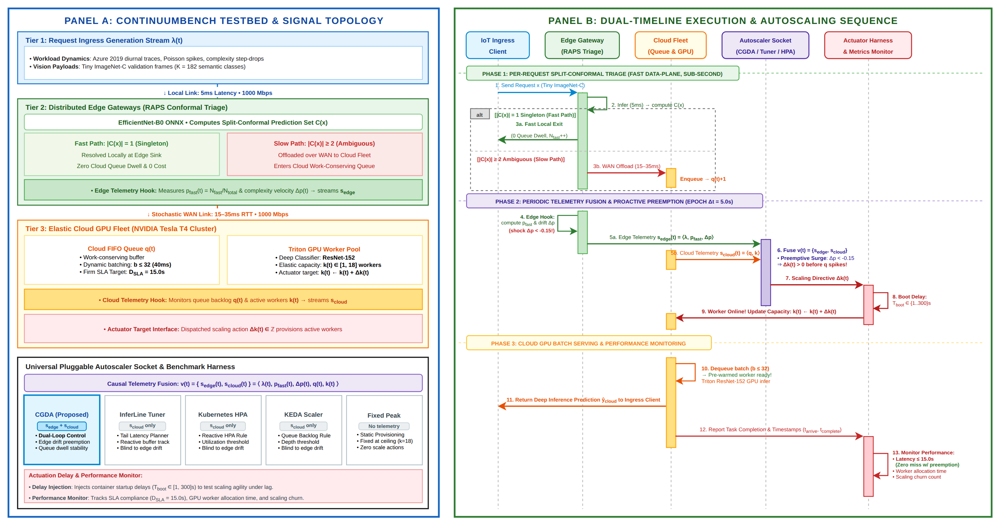

### Framework & Repository Linkage Map

The diagram below illustrates how simulation datasets, calibration manifests, OpenEvolve evolutionary policy search, and multi-seed evaluation modules link together:

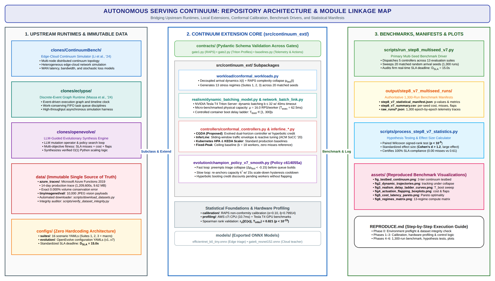

---

## Where Others Were at X, We Achieved Y

We evaluate CGDA against four de-branded baseline controllers across 1,300 matched evaluation runs ($20\text{ seeds} \times 13\text{ regimes} = 260$ paired observations per controller), with identical worker capacity $\mu = 16.0\text{ RPS}$ and $k_{\max} = 18$:

| Controller Architecture | Operational Policy | SLA Misses / Run | Compute Cost (WS/Run) | Relative Cost Savings | Scaling Churn / Run | P99 Tail Latency | Mean Queue Wait |
| :--- | :--- | :---: | :---: | :---: | :---: | :---: | :---: |
| **CGDA (Proposed)** | Conformal dual-horizon | **0.00 $\pm$ 0.00** | 700.0 $\pm$ 43.2 | **67.38% vs Peak** | 13.4 $\pm$ 1.1 | **5.10 $\pm$ 0.04s** | **3.9 ms** |
| **Predictive Traffic-Envelope** (InferLine) | Network-calculus bounds | 0.61 $\pm$ 0.68 | **620.4 $\pm$ 44.2** | 71.09% vs Peak | **5.2 $\pm$ 0.5** | 7.84 $\pm$ 0.31s | 175.8 ms |
| **Static Peak Provisioning** | Always-on ($k=18$) | 0.00 $\pm$ 0.00 | 2146.2 $\pm$ 60.5 | Baseline (0.0%) | 15.8 $\pm$ 0.1 | 5.00 $\pm$ 0.00s | 0.0 ms |
| **Reactive CPU-Utilization** (K8s HPA) | Utilization target $U=0.70$ | 15.46 $\pm$ 4.82 | 1825.3 $\pm$ 54.8 | 14.95% vs Peak | 52.8 $\pm$ 4.4 | 6.81 $\pm$ 0.39s | 42.0 ms |
| **Reactive Queue-Backlog** (KEDA) | Backlog target $q=5$ | 20.58 $\pm$ 4.05 | 1049.5 $\pm$ 48.7 | 51.10% vs Peak | 124.4 $\pm$ 4.9 | 8.64 $\pm$ 0.24s | 124.2 ms |

### Key Relative Findings in Nominal Settings ($T_{\text{boot}} = 1.0\text{ s}$)
- **Versus Static Peak Provisioning**: CGDA achieves the exact same zero-miss reliability ($0.00$ vs $0.00$ misses) while slashing compute cost by **67.38%** ($p = 2.07 \times 10^{-44}$, paired Wilcoxon signed-rank test).
- **Versus Reactive Scalers (Kubernetes HPA & KEDA)**: Where CPU HPA incurred $15.5$ misses/run and KEDA incurred $20.6$ misses/run under sudden complexity shifts, CGDA incurred **$0.00$ misses**. Furthermore, CGDA reduced actuation flapping by **74.6%** vs CPU HPA and **89.2%** vs KEDA.
- **Versus Predictive Traffic-Envelope (InferLine)**: InferLine is exceptionally cost-efficient, provisioning at steady-state bounds ($620.4\text{ WS}$ vs CGDA's $700.0\text{ WS}$, a $+12.8\%$ cost premium for CGDA). In exchange for this preemption buffer, CGDA reduces P99 tail latency by **35.0%** ($5.10\text{ s}$ vs $7.84\text{ s}$, $p = 5.46 \times 10^{-43}$) and eliminates transient deadline breaches under bursty arrivals ($0.00$ vs $0.61$ misses/run, $p = 0.025$).

---

## The Primary Spotlight: Boot Delay Ladder Benchmark ($T_{\text{boot}} \in [1, 300]\text{ s}$)

While nominal evaluations ($T_{\text{boot}} = 1.0\text{ s}$) show competitive performance across dynamic scalers, the real differentiator emerges under **realistic container startup delays**:

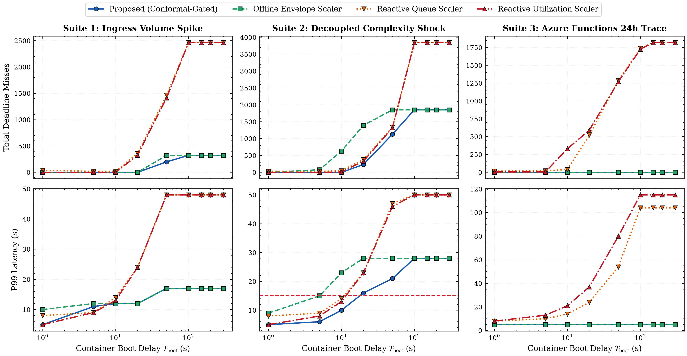

### Total SLA Deadline Misses across 19,750 Requests (Spike, Shock & Azure Regimes)

| Startup Delay $T_{\text{boot}}$ | **CGDA (Proposed)** | Predictive (InferLine) | Reactive CPU (HPA) | Reactive Queue (KEDA) | Static Peak ($k=18$) |
| :---: | :---: | :---: | :---: | :---: | :---: |
| **1.0 s** | **0** | **0** | 5 | 89 | 0 |
| **5.0 s** | **0** | 77 | 6 | 69 | 0 |
| **10.0 s** ($< D_{\text{SLA}}$) | **0** | 631 *(6.95% fail)* | 339 | 110 | 0 |
| **20.0 s** ($> D_{\text{SLA}}$) | **232** | 1,393 | 1,246 | 1,261 | 0 |
| **50.0 s** | **1,328** | 2,174 | 4,004 | 4,087 | 0 |
| **100.0 s** | 2,176 *(saturates)* | 2,176 *(saturates)* | 8,033 | 8,047 | 2,176 *(saturates)* |
| **150.0 s – 300.0 s** | 2,176 *(saturates)* | 2,176 *(saturates)* | 8,126 | 8,126 | 2,176 *(saturates)* |

### Insights from the Boot Delay Ladder
1. **Sub-Tipping-Point Preemption ($T_{\text{boot}} \le 10\text{ s}$)**:
   - At $T_{\text{boot}} = 5\text{ s}$, InferLine begins experiencing deadline misses ($77$ misses), while CGDA maintains **0 misses**.
   - At $T_{\text{boot}} = 10\text{ s}$, InferLine suffers $631$ deadline misses and CPU HPA suffers $339$ misses. CGDA’s feed-forward complexity derivative triggers preemption early enough to maintain **0 misses**.
2. **Super-Tipping-Point Backlog Mitigation ($T_{\text{boot}} = 20\text{ s}$)**:
   - When boot delay exceeds the SLA deadline ($T_{\text{boot}} = 20\text{ s} > D_{\text{SLA}} = 15.0\text{ s}$), no dynamic controller can prevent misses entirely. However, CGDA restricts deadline misses to **232**, reducing failures by **83.3%** compared to InferLine ($1,393$ misses) and reactive scalers ($1{,}246\text{--}1{,}261\text{ misses}$).
3. **Physical Saturation Boundary ($T_{\text{boot}} \ge 100\text{ s}$)**:
   - When boot delay exceeds the simulation episode duration ($T_{\text{boot}} \ge T_{\text{sim}} \approx 90\text{ s}$), all controllers—including Static Peak Provisioning—saturate identically at $2,176$ misses. This confirms that saturation is a physical horizon boundary rather than an algorithmic policy failure.

---

## Detailed Benchmark Galleries

| Dynamic Trajectories under Complexity Shock | Actuation Flapping & Scaling Churn Distributions |
| :---: | :---: |
| 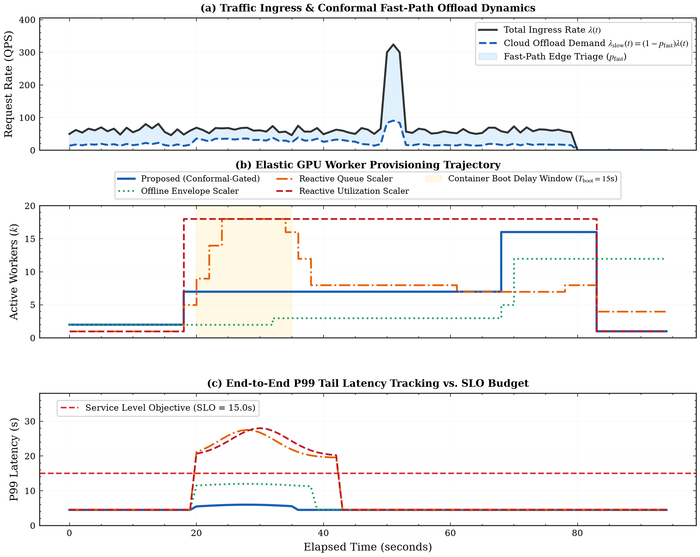 | 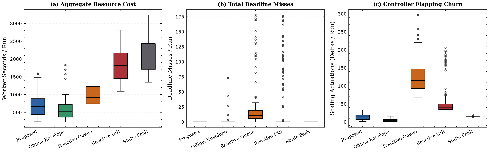 |
| **Cost-Latency Pareto Frontier** | **Cross-Regime Provisioning Efficiency** |
| 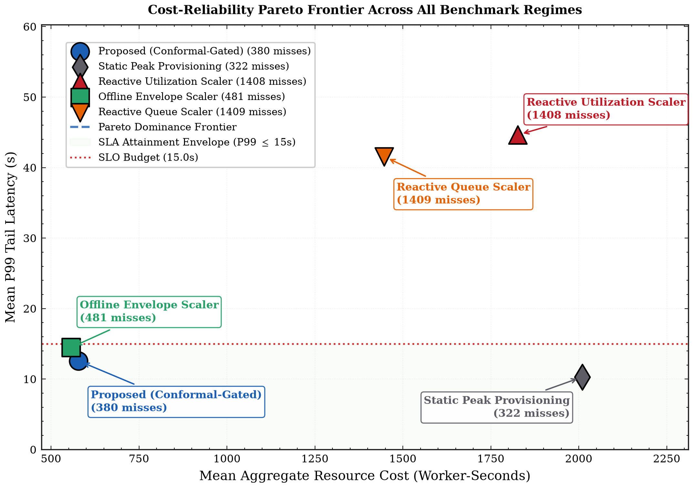 | 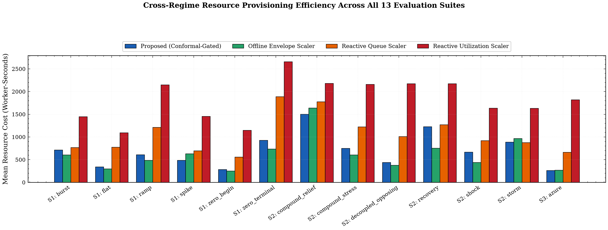 |

---

## Explicit Trade-Offs & Use-Case Fit

No autoscaler is universally optimal for every deployment. Here is an explicit breakdown of trade-offs:

### Strengths & Advantages
- **Early Preemptive Trigger**: Anticipates cloud queue surges using edge conformal set cardinality before backlog forms.
- **Actuation Churn Elimination**: Booting-credit lock ($C_{\text{boot}}(t)$) and asymmetric hysteresis reduce scaling flapping by $74.6\%\text{--}89.2\%$.
- **Robustness to Moderate Boot Delays**: Provides zero deadline misses up to $T_{\text{boot}} \le 10\text{ s}$ and mitigates backlog by $83.3\%$ at $T_{\text{boot}} = 20\text{ s}$.

### Disadvantages & Cost Premium
- **Compute Cost Premium**: CGDA pays a **$+12.8\%$ worker-second premium** ($700.0\text{ WS}$ vs $620.4\text{ WS}$) over InferLine. By holding a small preemption reserve, CGDA prioritizes strict SLA compliance over absolute minimum cost.
- **Edge Telemetry Dependency**: Requires an edge triage model capable of computing uncertainty/conformal sets (e.g., RAPS scores) and streaming telemetry ($p_{\text{fast}}(t)$) to the cloud controller.
- **Physical Boundary Invariance**: Like all dynamic autoscalers, CGDA cannot overcome physics when $T_{\text{boot}} \gg D_{\text{SLA}}$; in such environments, warm worker pools or container acceleration are mandatory.

### When to Use Which Scaler?

| Use-Case Scenario | Recommended Controller | Primary Rationale |
| :--- | :---: | :--- |
| **Edge-Cloud Split Inference with Strict SLAs** | **CGDA** | Preempts complexity shocks under container startup lags ($1\text{ s} \le T_{\text{boot}} \le 15\text{ s}$). |
| **Cost-Dominant / Batch Inference** | **InferLine** | Minimizes worker-seconds ($620.4\text{ WS}$) when occasional queue buffering is acceptable. |
| **Homogeneous Microservices (Zero Startup Lag)** | **Kubernetes HPA** | Simpler CPU/traffic rules suffice when container scale-up is instantaneous. |
| **Bursty Event-Driven Background Jobs** | **KEDA** | Direct queue-backlog tracking is effective when tail latency is not critical. |

---

## Repository Structure

```
.
├── calibration/
│   ├── train_distill.py             # Knowledge distillation (ResNet-152 -> EfficientNet-B0) & RAPS calibration
│   └── configs/calibration_config.json # Certified RAPS (q_hat=0.79914, alpha=0.10) & hardware constants
├── configs/
│   └── suites/                      # Benchmark regime workload configurations (Suites 1, 2, and 3)
├── data/
│   ├── azure_traces/                # Authoritative Azure Functions 2019 processed trace (14-day)
│   └── tinyimagenet/val/            # 10,000 validation images across 182 calibrated classes
├── models/
│   ├── efficientnet_b0_tiny.onnx    # Distilled edge triage ONNX model (dynamic batching)
│   └── gate6_resnet152.onnx         # Cloud worker heavy model ONNX
├── src/
│   └── continuum_ext/               # Simulation engine, controllers, telemetry hooks, and models
├── scripts/
│   ├── verify_dataset_integrity.py  # Cryptographic SHA-256 and physical invariant auditor
│   ├── run_suite_baselines.py       # Canonical baseline evaluation suite runner (13 regimes)
│   ├── run_step8_multiseed_v7.py    # Multi-seed validation engine (20 seeds x 13 regimes)
│   ├── process_step8_v7_statistics.py # Statistical report and paired Wilcoxon testing engine
│   ├── evaluate_v7_raw_results.py   # 9-point physical boot delay ladder sensitivity runner
│   ├── generate_paper_tables_v7.py  # Paper table aggregator and CSV/Markdown/LaTeX generator
│   └── generate_paper_figures_v7.py # High-DPI publication figure generation suite
├── output/
│   ├── paper_data/                  # Canonical output tables (Tables 1, 2, 3, and 4)
│   └── step8_v7_multiseed_runs/     # Authoritative statistical manifests and summary CSVs
├── assets/                          # Web-ready diagrams and benchmark result figures
├── REPRODUCE.md                     # Step-by-step reproduction manual with mathematical derivations
└── requirements.txt                 # Pinned dependencies for Python 3.12
```

---

## Quickstart Reproduction

To reproduce the benchmark findings step-by-step:

```bash
# 1. Setup virtual environment
python3 -m venv .venv
source .venv/bin/activate
pip install -r requirements.txt

# 2. Verify dataset integrity (SHA-256 and physical invariants)
./.venv/bin/python -m scripts.verify_dataset_integrity

# 3. Run a quick validation smoke test
./.venv/bin/python -m scripts.run_step8_multiseed_v7 --seeds 1
```

For the comprehensive, phased reproduction guide (including underlying mathematical formulas, multi-seed statistical runs, boot delay sweeps, and table generation), see [**`REPRODUCE.md`**](REPRODUCE.md).

---

## Project Status & Licensing

This is an independent personal research project with manuscript publication underway. Formal open-source licensing will be established upon paper publication; all rights reserved until initial release.
