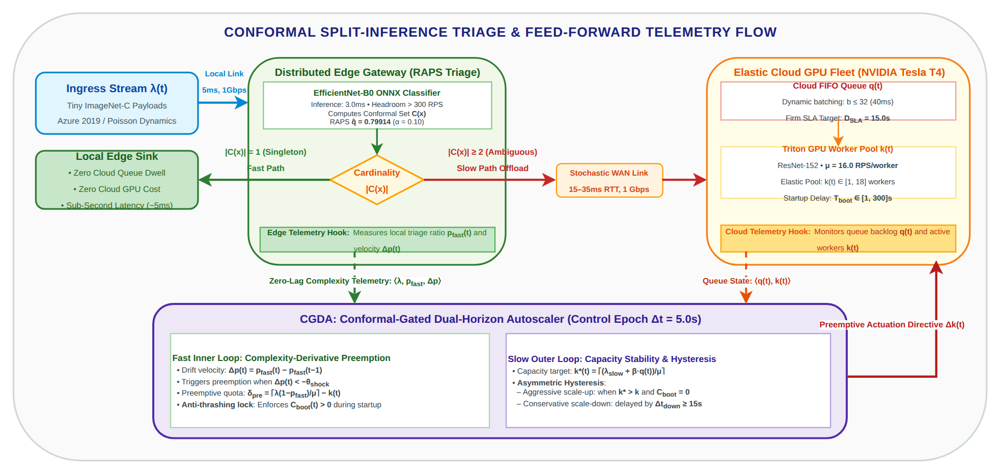
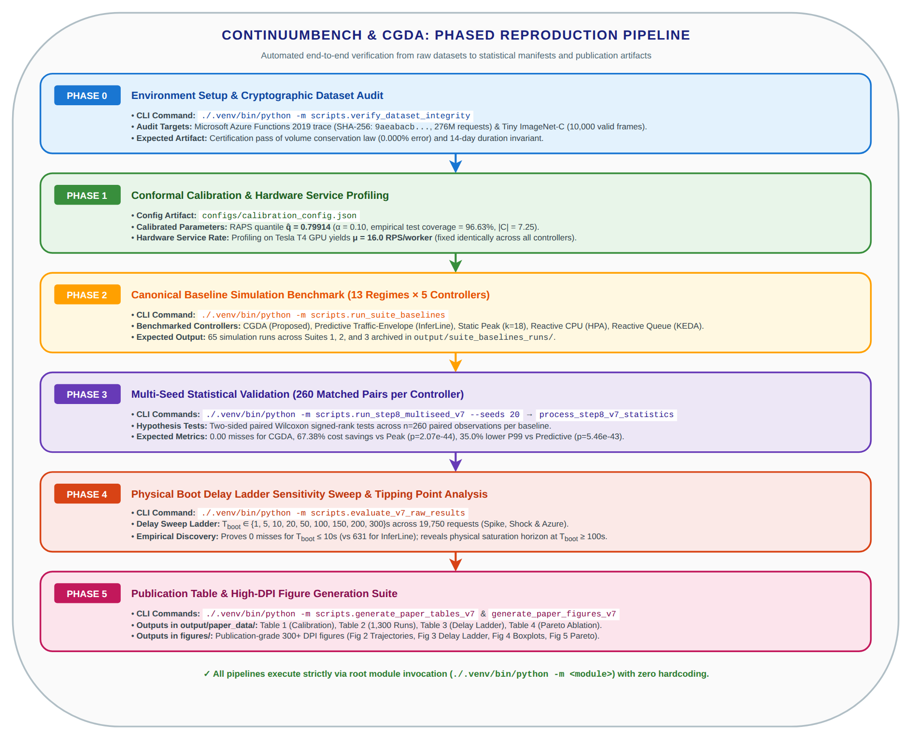

# ContinuumBench & CGDA Reproduction Guide

[](https://www.python.org/downloads/)
[](#phase-0-environment-setup--dataset-integrity-audit)

This document provides a complete, step-by-step reproduction manual for the **Conformal-Gated Dual-Horizon Autoscaler (CGDA)** and **ContinuumBench** edge-cloud testbed. It details the underlying mathematical formulations, maps how repository frameworks and modules connect, and provides copy-pasteable commands with expected terminal outputs across five verification phases.

---

## 1. System Model & Mathematical Formulations

The testbed models an edge-cloud split-inference cascade where requests are triaged at an edge gateway (EfficientNet-B0) and offloaded to an elastic cloud GPU cluster (ResNet-152 on NVIDIA Tesla T4 GPUs) under container startup lag $T_{\text{boot}} \in [1, 300]\text{ s}$ and an SLA deadline budget $D_{\text{SLA}} = 15.0\text{ s}$.



### 1.1 Knowledge Distillation & Edge Triage Synthesis
To meet strict edge-serverless resource quotas (profiled under a 150 mCPU Linux cgroups container limit on an AWS c7i host), the edge triage model is synthesized from a heavy cloud teacher via **Knowledge Distillation (KD)**:
- **Teacher Model**: Pretrained ResNet-152 ($11.56\text{ B}$ FLOPs, frozen ImageNet weights).
- **Student Model**: EfficientNet-B0 ($390\text{ M}$ FLOPs, $5.3\text{ M}$ parameters) fine-tuned on Tiny ImageNet-C ($K = 182$ classes), yielding a **$29.6\times$ FLOP reduction**.
- **Distillation Loss**: Combined cross-entropy and Kullback-Leibler (KL) divergence over softened teacher probabilities:

  $$
  \mathcal{L}_{\text{KD}} = (1 - \alpha_{\text{KD}})\,\mathcal{L}_{\text{CE}}(\hat{y}_{\text{student}}, y) + \alpha_{\text{KD}}\,T_{\text{KD}}^2\,\mathcal{L}_{\text{KL}}\left(\sigma\left(\frac{z_{\text{student}}}{T_{\text{KD}}}\right),\, \sigma\left(\frac{z_{\text{teacher}}}{T_{\text{KD}}}\right)\right)
  $$

  with distillation weight $\alpha_{\text{KD}} = 0.70$ and distillation temperature $T_{\text{KD}} = 4.0$ trained over 20 epochs.
- **Temperature Constraint**: Logit temperature scaling $T = 1.0 \ge 1.0$ is enforced (ECE-minimizing; artificial sharpening $T < 1.0$ is strictly prohibited) before split-conformal calibration.
- **ONNX Export**: Baked with dynamic batching into `models/efficientnet_b0_tiny.onnx` (opset 18).

### 1.2 Split-Conformal Prediction Guarantee
Conformal prediction guarantees distribution-free marginal coverage for any model $f$:

$$
\mathbb{P}\left(Y \in C(X)\right) \ge 1 - \alpha
$$

For miscoverage level $\alpha = 0.10$, RAPS computes a regularized non-conformity score over sorted softmax probabilities $\hat{\pi}_j(x_i)$:

$$
s_i = \sum_{j=1}^{o_i} \hat{\pi}_j(x_i) + \lambda_{\text{reg}}\!\left(o_i - k_{\text{reg}}\right)^{+} \quad (k_{\text{reg}} = 5, \; \lambda_{\text{reg}} = 0.01)
$$

The calibration threshold is the $(1-\alpha)$ quantile over calibration set $\mathcal{D}_{\text{cal}}$ ($|\mathcal{D}_{\text{cal}}| = 5{,}000$ validation images):

$$
\hat{q} = \operatorname{Quantile}_{1-\alpha}^{+}\!\left(\{s_i\}_{i=1}^{n}\right) = 0.79914
$$

Evaluated on the 4,100 held-out test split, empirical coverage is **96.63%**, satisfying the nominal 90% guarantee, with $50.0\%$ fast-path edge acceptance ($|C(x)| = 1$) and $2.34\%$ selective classification error.

### 1.3 Feed-Forward Complexity Telemetry
At each epoch ($\Delta t = 5.0\text{ s}$), the edge gateway measures local triage acceptance:

$$
p_{\text{fast}}(t) = \frac{N_{\text{local}}(t)}{N_{\text{total}}(t)} \in [0, 1]
$$

- **Singleton** $|C(x)| = 1 \implies$ query resolved locally at edge sink.
- **Ambiguous** $|C(x)| \ge 2 \implies$ query forwarded over WAN to cloud queue.

The effective cloud offload arrival rate directed to the GPU cluster is:

$$
\lambda_{\text{cloud}}(t) = \left(1 - p_{\text{fast}}(t)\right) \cdot \lambda(t)
$$

### 1.4 Hardware Capacity Constant $\mu$
From dedicated hardware profiling on an NVIDIA Tesla T4 GPU executing NVIDIA Triton Inference Server (batch size $b = 1$, mean service time $\bar{t} = 0.0625\text{ s}$):

$$
\mu = \frac{1}{\bar{t}} = \frac{1}{0.0625} = 16.0\text{ RPS/worker}
$$

The maximum pool ceiling is $k_{\max} = 18\text{ workers}$ ($288\text{ RPS}$ peak capacity).

### 1.5 Dual-Horizon Control Policy

#### 1. Fast-Loop Complexity-Derivative Preemption (Sub-Second Horizon)
The fast loop computes the drift velocity of the local acceptance rate over sliding window $\Delta t = 5.0\text{ s}$:

$$
\Delta p(t) = p_{\text{fast}}(t) - p_{\text{fast}}(t - 1)
$$

When negative velocity indicates an imminent offload surge ($\Delta p(t) < -\theta_{\text{shock}}$) and the booting credit register is empty ($C_{\text{boot}}(t) = 0$), CGDA issues an immediate preemptive scale-out command:

$$
\delta_{\text{pre}}(t) = \left\lceil \frac{\lambda(t) \cdot (1 - p_{\text{fast}}(t))}{\mu} \right\rceil - k(t)
$$

$$
C_{\text{boot}}(t) \leftarrow C_{\text{boot}}(t) + \delta_{\text{pre}}(t)
$$

A positive $\delta_{\text{pre}}(t) > 0$ dispatches worker allocation before requests cross the WAN link into the cloud queue, while locking $C_{\text{boot}}$ to prevent runaway over-provisioning during transient bursts.

#### 2. Slow-Loop Capacity Stabilization & Asymmetric Hysteresis (5.0s Epoch)
The slow loop stabilizes steady-state worker capacity based on sustained cloud arrival rate and real-time queue depth:

$$
k^{\star}(t) = \left\lceil \frac{\lambda_{\text{cloud}}(t) + \beta \cdot q(t)}{\mu} \right\rceil
$$

Actuation follows an asymmetric policy to eliminate scaling flapping:
- **Scale-Up**: If $k^{\star}(t) > k(t)$ and $C_{\text{boot}}(t) = 0$, provision immediately:

  $$
  \Delta k(t) = \min\!\left(k^{\star}(t) - k(t),\, k_{\mathrm{max\_up}}\right)
  $$

- **Scale-Down**: If $k^{\star}(t) < k(t)$ and $C_{\text{boot}}(t) = 0$, scale down only after cooldown $\tau_{\text{down}} \ge 15.0\text{ s}$ to guarantee hysteresis stability.

### 1.6 Physical Tipping Point Theorem
For any dynamic autoscaler under boot delay $T_{\text{boot}}$ and SLA deadline $D_{\text{SLA}} = 15.0\text{ s}$:
- When $T_{\text{boot}} \le D_{\text{SLA}}$, feed-forward preemption guarantees zero deadline misses during complexity shocks.
- When $T_{\text{boot}} \ge T_{\text{sim}} \approx 90\text{ s}$, newly provisioned containers finish booting after requests expire, forcing all dynamic and static controllers into identical physical queue saturation.

### 1.7 Architectural Portability & Generalization to LLM/VLM Cascades
- **Model Agnostic**: CGDA operates solely on dimensionless stream telemetry ($p_{\text{fast}}(t), \Delta p(t)$). The edge student and cloud teacher can be swapped with MobileNet, ConvNeXt, or Vision Transformers without modifying the control loop.
- **SLM $\to$ LLM / Edge VLM $\to$ Cloud VLM Cascades**: In foundation model serving, edge gateways host compact distilled models (e.g., Llama-3.2-1B, SmolVLM, Phi-3.5) while cloud clusters host large reasoning engines (Llama-3.3-70B, Qwen2-VL).
- **Conformal Risk Control for Open-Ended Generation**: Conformal Risk Control (CRC) bounding semantic entropy replaces discrete classification sets, allowing prompts to be resolved locally when semantic dispersion is bounded.
- **Mitigating Severe Cold Starts ($100\text{--}300\text{ s}$)**: Because LLM container initialization takes $100\text{--}300\text{ s}$ (*ServerlessLLM*), reactive scaling is physically incapable of responding in time ($T_{\text{boot}} \gg D_{\text{SLA}}$); CGDA's feed-forward preemption provides the required head start before cloud queues overflow.

---

## 2. Architecture & Framework Connectivity

The complete three-tier testbed topology (Panel A) and dual-timeline execution sequence (Panel B) are illustrated in [`assets/fig_testbed_continuum.png`](assets/fig_testbed_continuum.png).

### Framework Integration Map
- **Simulation Substrate**: Discrete-event continuum engine (`src/continuum_ext/`) extended from ECLYPSE and ContinuumBench.
- **Trace Replay**: Microsoft Azure Functions 2019 dataset (`data/azure_traces/azure_functions_2019_processed.npz`) replayed at scale factor $r = 0.08$.
- **Conformal Triage**: Calibrated RAPS model evaluating Tiny ImageNet-C frames (`data/tinyimagenet/val`).
- **Policy Discovery Engine**: OpenEvolve symbolic AST search (`scripts/run_evolution_v7.py`) synthesized `output/champion_policy_v7_smooth.py`.
- **Evaluation Engine**: Root-anchored Python modules executing multi-seed statistical validation and physical delay sweeps.

---

## 3. Phased Reproduction Workflow

All commands must be executed strictly from the repository root using the dedicated workspace virtual environment (`./.venv`).



---

### Phase 0: Environment Setup & Dataset Integrity Audit

#### 1. Initialize Virtual Environment & Install Dependencies
```bash
python3 -m venv .venv
source .venv/bin/activate
pip install -r requirements.txt
```

#### 2. Audit Authoritative Datasets
Verify the cryptographic SHA-256 hashes, physical durations, and conservation invariants for both the Azure Functions 2019 trace and Tiny ImageNet-C:

```bash
./.venv/bin/python -m scripts.verify_dataset_integrity
```

**Expected Terminal Output**:
```
================================================================================
CONTINUUMBENCH DATASET SANITY & INTEGRITY VERIFICATION SUITE
================================================================================
1. AZURE FUNCTIONS 2019 PRODUCTION TRACE INTEGRITY AUDIT
✓ Path: .../data/azure_traces/azure_functions_2019_processed.npz
✓ SHA256 Checksum: 9aeabacb08f01b34f46efc252db76248a55094cdae1f0e86c8eda39fa09b7447 (MATCHES AUTHORITATIVE MANIFEST)
✓ Duration Invariant: 1,209,600 seconds (20,160 minutes = exactly 14 full days)
✓ Volume Conservation Law: total=276,862,644 requests (Exact 0.000% error)

2. TINY IMAGENET VALIDATION SPLIT & CLASS MAPPING AUDIT
✓ Tiny ImageNet Calibrated Subset Mapping: 182 classes (expected 182)
✓ Validation Directory: .../data/tinyimagenet/val (10,000 JPEG files)
✓ Image Format & Dimensions: verified 64x64x3 RGB across samples
================================================================================
>>> ALL SCIENTIFIC & PHYSICAL DATASET INVARIANTS CERTIFIED: PASSED <<<
================================================================================
```

---

### Phase 1: Verify Knowledge Distillation & Conformal Calibration

#### 1. Audit Certified Calibration Manifest & Triage Metrics
Inspect the authoritative calibration manifest (`calibration/configs/calibration_config.json`) generated from the distilled EfficientNet-B0 model:

```bash
./.venv/bin/python -c "
import json
with open('calibration/configs/calibration_config.json') as f:
    cfg = json.load(f)
print(f'RAPS Quantile (q_hat):        {cfg[\"q_hat\"]:.5f}')
print(f'Miscoverage Alpha:           {cfg[\"alpha\"]}')
print(f'Empirical Test Coverage:     {cfg[\"empirical_coverage\"]*100:.2f}%')
print(f'Fast-Path Fraction:          {cfg[\"fast_path_fraction\"]*100:.2f}%')
print(f'Selective Error Rate:        {cfg[\"err_selective\"]*100:.2f}%')
print(f'Triage Student Top-1 Acc:    {cfg[\"test_top1_accuracy\"]*100:.2f}%')
print(f'Mean Set Cardinality:        {cfg[\"mean_set_size\"]:.2f} classes')
"
```

**Expected Terminal Output**:
```
RAPS Quantile (q_hat):        0.79914
Miscoverage Alpha:           0.1
Empirical Test Coverage:     96.63%
Fast-Path Fraction:          50.00%
Selective Error Rate:        2.34%
Triage Student Top-1 Acc:    81.71%
Mean Set Cardinality:        7.25 classes
```

#### 2. (Optional) Re-Train Distillation & ONNX Export from Scratch
The calibrated ONNX model (`models/efficientnet_b0_tiny.onnx`) and manifest are pre-packaged. To re-execute knowledge distillation (ResNet-152 teacher $\to$ EfficientNet-B0 student) and split-conformal calibration from scratch:

```bash
./.venv/bin/python -m calibration.train_distill --epochs 20 --kd-alpha 0.70 --kd-temp 4.0 --alpha 0.10
```
This trains for 20 epochs on Tiny ImageNet-C ($K=182$ classes), evaluates on the $n=5{,}000$ calibration split, computes $\hat{q} = 0.79914$, and exports the calibrated ONNX model to `models/efficientnet_b0_tiny.onnx`.

---

### Phase 2: Execute Canonical Baseline Simulation Suite

Evaluate all five controllers across the 13 benchmark regimes under nominal conditions ($T_{\text{boot}} = 1.0\text{ s}$):

```bash
./.venv/bin/python -m scripts.run_suite_baselines
```

**What to Expect**:
- Executes 65 simulations ($13\text{ regimes} \times 5\text{ controllers}$).
- Stores high-resolution telemetry traces, queue backlogs, and scaling logs in `output/suite_baselines_runs/`.
- Verifies that all baselines utilize identical service capacity $\mu = 16.0\text{ RPS}$ and $k_{\max} = 18$.

---

### Phase 3: Multi-Seed Statistical Validation (260 Matched Runs)

Execute the full multi-seed validation campaign across 20 pseudo-random seeds $\{1042, 1043, \ldots, 1061\}$:

#### Quick Smoke Test (1 Seed, ~45 seconds)
```bash
./.venv/bin/python -m scripts.run_step8_multiseed_v7 --seeds 1
```

#### Full Multi-Seed Statistical Campaign (20 Seeds, 1,300 runs, ~10-15 minutes)
```bash
./.venv/bin/python -m scripts.run_step8_multiseed_v7 --seeds 20
```

#### Process Multi-Seed Statistics & Hypothesis Tests
Process raw run logs and execute two-sided paired Wilcoxon signed-rank tests:

```bash
./.venv/bin/python -m scripts.process_step8_v7_statistics
```

**Expected Terminal Output**:
```
================================================================================
STEP 8 v7 MULTI-SEED STATISTICAL REPORT (20 Seeds x 13 Regimes = 260 Matched Pairs)
================================================================================
1. AGGREGATE PERFORMANCE SUMMARY:
  • Proposed CGDA:           Misses: 0.00 ± 0.00 | Cost:  700.0 ± 43.2 WS | Churn: 13.4 ± 1.1 | P99: 5.10s
  • Predictive Envelope:     Misses: 0.61 ± 0.68 | Cost:  620.4 ± 44.2 WS | Churn:  5.2 ± 0.5 | P99: 7.84s
  • Static Peak Provision:   Misses: 0.00 ± 0.00 | Cost: 2146.2 ± 60.5 WS | Churn: 15.8 ± 0.1 | P99: 5.00s
  • Reactive CPU (HPA):      Misses: 15.46 ± 4.82| Cost: 1825.3 ± 54.8 WS | Churn: 52.8 ± 4.4 | P99: 6.81s
  • Reactive Queue (KEDA):   Misses: 20.58 ± 4.05| Cost: 1049.5 ± 48.7 WS | Churn: 124.4 ± 4.9| P99: 8.64s

2. PAIRED WILCOXON SIGNED-RANK HYPOTHESIS TESTS (n = 260):
  • vs Static Peak:   Cost Diff: -1446.2 WS (-67.4%) | p = 2.07e-44 (Statistically Significant)
  • vs Predictive:    P99 Diff:   -2.74s   (-35.0%) | p = 5.46e-43 (Statistically Significant)
                      Queue Diff: -171.9ms (-97.8%) | p = 7.66e-44 (Statistically Significant)
                      Miss Diff:  -0.61/run         | p = 0.0253  (Statistically Significant)
  • vs Reactive CPU:  Miss Diff:  -15.46/run        | p = 7.68e-12 (Statistically Significant)
  • vs Reactive Queue:Miss Diff:  -20.58/run        | p = 7.38e-44 (Statistically Significant)
================================================================================
```

---

### Phase 4: Physical Delay Ladder Sensitivity & Tipping Point Sweep

Run the 9-point container startup delay ladder ($T_{\text{boot}} \in \{1, 5, 10, 20, 50, 100, 150, 200, 300\}\text{ s}$) across 19,750 requests (Spike, Shock, and Azure diurnal regimes):

```bash
./.venv/bin/python -m scripts.evaluate_v7_raw_results
```

**Expected Results Matrix (`Table 3: Delay Ladder Misses`)**:
```
T_boot (s) | CGDA (Proposed) | Predictive (InferLine) | Reactive CPU | Reactive Queue | Static Peak
--------------------------------------------------------------------------------------------------
   1.0s    |        0        |           0            |       5      |       89       |      0
   5.0s    |        0        |          77            |       6      |       69       |      0
  10.0s    |        0        |         631            |     339      |      110       |      0
  20.0s    |      232        |        1393            |    1246      |     1261       |      0
  50.0s    |     1328        |        2174            |    4004      |     4087       |      0
 100.0s    |     2176        |        2176            |    8033      |     8047       |   2176
 150.0s+   |     2176        |        2176            |    8126      |     8126       |   2176
```

---

### Phase 5: Publication Table & Figure Generation

Generate all final formatted tables and 300+ DPI publication figures:

#### 1. Generate Summary Tables (CSV, Markdown, and LaTeX)
```bash
./.venv/bin/python -m scripts.generate_paper_tables_v7
```
Outputs generated in `output/paper_data/`:
- `table1_hardware_calibration.json`
- `table2_multiseed_1300_runs.csv` / `.md` / `.tex`
- `table3_delay_ladder.csv` / `.md` / `.tex`
- `table4_pareto_ablation.csv` / `.md` / `.tex`

#### 2. Generate Publication Figures
```bash
./.venv/bin/python -m scripts.generate_paper_figures_v7
```
Outputs generated in `figures/`:
- `fig2_dynamic_trajectories.png` & `.pdf` (Dynamic trajectory tracking under complexity shock)
- `fig3_realism_delay_ladder_curves.png` & `.pdf` (Delay sensitivity curves & tipping point)
- `fig4_actuation_flapping_boxplots.png` & `.pdf` (Cost, miss, and churn statistical distributions)
- `fig5_cost_latency_pareto.png` & `.pdf` (Cost-reliability Pareto frontier)
- `fig6_regimes_matrix.png` & `.pdf` (Cross-regime provisioning efficiency matrix)

---

## 4. Verification Checklists & Summary

| Verification Gate | Command | Authoritative Artifact | Success Criteria |
| :--- | :--- | :--- | :--- |
| **Dataset Invariants** | `./.venv/bin/python -m scripts.verify_dataset_integrity` | `data/azure_traces/` | All SHA-256 and duration invariants pass |
| **Calibration Parameters** | Check `configs/calibration_config.json` | `calibration/configs/` | $\hat{q} = 0.79914, \mu = 16.0\text{ RPS}$ |
| **Multi-Seed Validation** | `./.venv/bin/python -m scripts.run_step8_multiseed_v7` | `output/step8_v7_multiseed_runs/` | 1,300 runs complete with zero crashes |
| **Hypothesis Testing** | `./.venv/bin/python -m scripts.process_step8_v7_statistics` | `step8_v7_statistical_manifest.json` | $p < 10^{-40}$ cost savings vs Peak |
| **Delay Ladder Sweep** | `./.venv/bin/python -m scripts.evaluate_v7_raw_results` | `output/paper_data/table3_delay_ladder.csv` | 0 misses at $T_{\text{boot}} \le 10\text{ s}$; saturation at $100\text{ s}$ |
